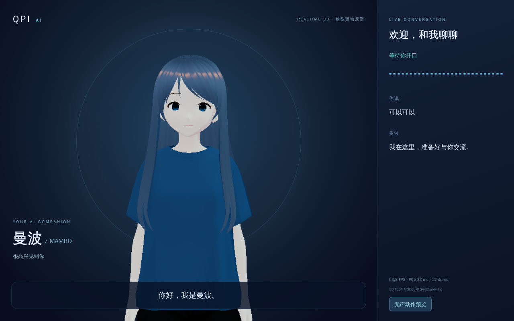

# Realtime 3D Digital Human Voice Assistant

[中文](README_zh.md) | English

This project is a realtime voice-conversation demo with a 3D digital human implemented on the [Quectel Pi Smart Single-Board Computer](https://www.quectel.com.cn/quectel-pi/documentation-center).
The board captures microphone audio, streams it to the Quectel cloud where VAD, ASR, LLM and TTS all run, and plays the synthesized speech back through the speaker while driving the avatar's lip movement from the real audio envelope.
The 3D character is rendered by WebGL in the local browser, so the board only needs to compute viseme parameters and publish them over a loopback HTTP bridge.



## Features

- Realtime full-duplex voice conversation with cloud-side VAD, ASR, LLM and TTS
- Audio-driven lip sync computed from the actual playback PCM, not from timers
- 3D VRM avatar rendered on the GPU through three.js, driven by viseme and VRM expression blendshapes
- Built-in acoustic echo cancellation so the assistant does not interrupt itself
- Native C implementation: low CPU and memory footprint, no Python runtime on the board
- Automatic reconnection when the cloud WebSocket drops
- Fully offline-capable UI: all frontend assets are served from the board itself

**Lip Sync Parameter Mapping**

> The mouth shape is derived from the real PCM that is currently being played, so the mouth stops the moment the audio stops.

|Parameter|Derived From|Drives|
|----------|---------|---------|
|openness|Log-compressed RMS envelope|Mouth opening amount|
|wide|Zero-crossing rate|Flat mouth shapes for sibilants and front vowels|
|round|Low-frequency (< 500 Hz) energy ratio|Rounded mouth shapes for rounded vowels|

## Hardware Requirements

- Quectel Pi M2 single-board computer (RK3576)
- Onboard DSI display (1280x800)
- Onboard microphone and speaker
- Network connectivity for the cloud AI service

## Software Environment Setup

> The board's PulseAudio server is provided by pipewire-pulse. The application must run as the desktop user, not as root, otherwise the PulseAudio connection is refused.

- Operating System: Debian 13
- Audio server: PipeWire with pipewire-pulse
- Browser: Firefox ESR (kiosk mode)
- Cloud service: Quectel AI Chat (WebSocket, Opus in / Opus out)
- Toolchain: `m2-debian-rootfs-toolchain` (gcc 14.2, glibc 2.38)

The system toolchain is not usable here. Its glibc is older than the one `libpulse` requires, so linking fails with an undefined `GLIBC_2.38` symbol.

### Implementation Steps

1. Clone the project using git.

```bash
sudo apt update
sudo apt install -y git
git clone https://github.com/Quectel-Pi/demo-digital-human.git
```

After execution, a `demo-digital-human` folder should be created in the current directory.

2. Enter the `c` directory and build.

The build needs the M2 cross toolchain, which is not part of this repository. Point the build at it explicitly.

```bash
cd demo-digital-human/c
make TC=/path/to/m2-debian-rootfs-toolchain
```

`TC` may also be supplied through the `M2_TOOLCHAIN` environment variable.

The Quectel cloud SDK is shipped prebuilt as `c/libs/libqthsdk.so` together with the headers it needs under `c/include/qthsdk/`, so no SDK source is required to build.

The build product is `demo030_voice`. It is a small binary of about 67 KB that loads the cloud SDK at runtime.

3. Deploy to the board over adb.

```bash
make deploy
```

This pushes the binary, the `web/` frontend and the start script into `/userdata/demo030`.

## Project Structure

```
demo-digital-human/
├── c/                              # Native C implementation
│   ├── src/
│   │   ├── main.c                  # Startup sequence and the conversation loop
│   │   ├── cloud_chat.c            # Quectel cloud SDK wrapper: PCM in, text + PCM out
│   │   ├── audio_io.c              # PulseAudio capture and playback with ring buffer
│   │   ├── avatar.c                # Viseme computation and state publication
│   │   └── avatar_web.c            # Loopback HTTP bridge serving /api/state
│   ├── include/                    # Application headers
│   │   └── qthsdk/                 # Cloud SDK headers (needed to compile)
│   ├── web/                        # 3D frontend
│   │   ├── index.html
│   │   ├── app.js                  # three.js + three-vrm scene and blendshape driving
│   │   ├── style.css
│   │   ├── model.vrm               # Sample VRM avatar
│   │   └── node_modules/           # Local copies of three.js and three-vrm
│   ├── libs/                       # Runtime shared objects
│   │   └── libqthsdk.so            # Prebuilt cloud SDK
│   ├── assets/licenses/            # Third-party license texts
│   ├── start_bg.sh                 # Board startup script
│   └── Makefile
├── docs/assets/main.png            # Screenshot
├── .gitignore
└── README.md
```

## Run the program

Start the script on the board as the desktop user. It raises the audio mixer, launches the application, and then opens Firefox in kiosk mode to display the 3D character.

```bash
su q -c /userdata/demo030/start_bg.sh
```

The script also accepts the following subcommands.

```bash
su q -c /userdata/demo030/start_bg.sh stop      # Stop
su q -c /userdata/demo030/start_bg.sh status    # Show process status
su q -c /userdata/demo030/start_bg.sh log       # Follow live.log
```

If the program starts successfully, the log shows the four subsystems coming up in order, and the browser displays the 3D character.

```
[PLAY] ✓ PulseAudio 播放流就绪 16000Hz/1ch/S16  tlength=150ms
[AVWEB] ✓ 界面已启动 1280x800 @25fps
[CC] ✓ 云端会话就绪 sid=sess_xxxxxxxx
[CAP] ✓ PulseAudio 录音流就绪 16000Hz/1ch/S16
```


## Audio Pipeline

The board acts as a thin client. All recognition and synthesis run in the cloud, which keeps the local CPU load low and the latency predictable.

- Capture: 16000 Hz, mono, S16LE, encoded to Opus at 24 kbps with 10 ms frames
- Transport: WebSocket to the Quectel AI Chat service
- Playback: Opus decoded to PCM and written to PulseAudio with a 150 ms target buffer
- Echo cancellation: the board's PipeWire echo-cancel module provides the paired nodes `mic-ns` and `mic-ns-sink`

Two details are easy to get wrong on this board.

`pa_simple_new` ignores its device parameter here, so selecting the echo-cancel nodes must be done through the default device instead.

```bash
pactl set-default-sink mic-ns-sink
pactl set-default-source mic-ns
```

If the playback stream lands on the bare speaker and the capture stream on the bare microphone, every sentence the avatar speaks is recorded again, and the cloud mistakes it for a user interruption.

The mouth position must also follow the real playback position rather than the write time. Because of the prefill and the PulseAudio buffer, the write time leads the actual sound by several hundred milliseconds, which would make the mouth open visibly early.

## Measured Performance

```
End-to-end latency    0.36 ~ 0.87 s
Underruns             0
Gaps between segments 0
TTS speed             1.00 ~ 1.03x realtime
CPU                   10 ~ 20 % (about 1.5 of 8 cores)
Memory                15 ~ 23 MB
```

## Third-Party Components

The sample VRM model is a pixiv test asset and is not licensed for commercial use. Replace it before shipping.

|Component|License|
|----------|---------|
|three.js|MIT|
|@pixiv/three-vrm|MIT|
|Opus|BSD-3-Clause|
|Sample VRM model|See `c/web/NOTICE.md`, test asset only|

## Reporting Issues
If you encounter any issues during use, please submit technical inquiries on the [Quectel Official Forum](https://forumschinese.quectel.com/c/quectel-pi/58). Our technical support team will respond promptly.
Issues and Pull Requests are welcome to help improve this project.
