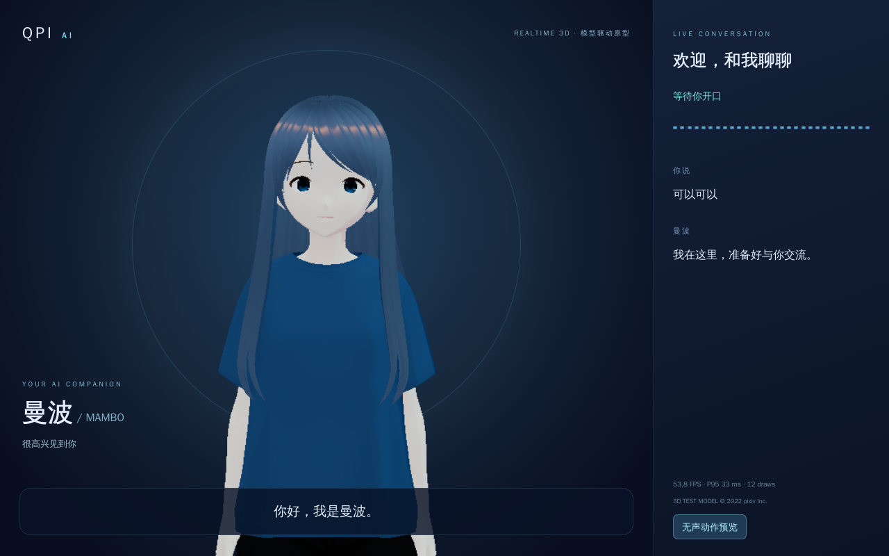

# 实时 3D 数字人语音助手

中文 | [English](README.md)

本项目是在 [Quectel Pi 智能单板计算机](https://www.quectel.com.cn/quectel-pi/documentation-center) 上实现的实时语音对话 3D 数字人演示。
板端采集麦克风音频并上传到移远云端，VAD、ASR、LLM、TTS 全部在云端完成；合成语音从喇叭播放的同时，口型由真实音频包络驱动。
3D 形象由浏览器通过 WebGL 渲染，板子只负责计算口型参数并通过本地回环 HTTP 桥发布出去。



## 功能特性

- 云端 VAD、ASR、LLM、TTS 全链路的实时语音对话
- 口型来自真实播放中的 PCM，不是按时钟推算
- 通过 three.js 在 GPU 上渲染 VRM 模型，由口型参数与 VRM 表情变形驱动
- 内置回声消除，喇叭播放不会触发误打断
- 纯 C 实现：资源占用低，板上不需要 Python 运行时
- 云端 WebSocket 断开后自动重连
- 界面完全离线可用：前端资源全部由板子自己提供

**口型参数映射**

> 口型取自当前正在播放的真实 PCM，声音一停嘴立即闭合。

|参数|来源|作用|
|----------|---------|---------|
|openness|对数压缩的音量包络|张嘴幅度|
|wide|过零率|齿音与前元音的扁平口型|
|round|500Hz 以下能量占比|圆唇音的圆形口型|

## 硬件要求

- Quectel Pi M2 单板计算机（RK3576）
- 板载 DSI 显示屏（1280x800）
- 板载麦克风与喇叭
- 可访问云端 AI 服务的网络环境

## 软件环境搭建

> 板上的 PulseAudio 服务由 pipewire-pulse 提供。程序必须以桌面用户身份运行，不能用 root，否则 PulseAudio 连接会被拒绝。

- 操作系统：Debian 13
- 音频服务：PipeWire + pipewire-pulse
- 浏览器：Firefox ESR（kiosk 模式）
- 云端服务：移远 AI Chat（WebSocket，Opus 上行 / Opus 下行）
- 交叉工具链：`m2-debian-rootfs-toolchain`（gcc 14.2，glibc 2.38）

系统自带的工具链在这里不可用。它的 glibc 版本低于 `libpulse` 的要求，链接时会报 `GLIBC_2.38` 符号未定义。

### 实施步骤

1. 使用 git 克隆项目。

```bash
sudo apt update
sudo apt install -y git
git clone https://github.com/Quectel-Pi/demo-digital-human.git
```

执行后当前目录下应生成 `demo-digital-human` 文件夹。

2. 进入 `c` 目录并编译。

编译需要 M2 交叉工具链，它不在本仓库内，编译时显式指过去即可。

```bash
cd demo-digital-human/c
make TC=/path/to/m2-debian-rootfs-toolchain
```

`TC` 也可以改用环境变量 `M2_TOOLCHAIN` 传入。

移远云端 SDK 以**预编译共享库**形式随仓库提供：`c/libs/libqthsdk.so`，配套头文件在 `c/include/qthsdk/`，因此编译不需要 SDK 源码。

编译产物为 `demo030_voice`，体积约 67KB，运行时动态加载云端 SDK。

3. 通过 adb 部署到板子。

```bash
make deploy
```

该命令会把可执行文件、`web/` 前端与启动脚本推送到板上的 `/userdata/demo030`。

## 项目结构

```
demo-digital-human/
├── c/                              # 原生 C 实现
│   ├── src/
│   │   ├── main.c                  # 启动流程与对话主循环
│   │   ├── cloud_chat.c            # 移远云端 SDK 封装：喂入 PCM，取出文本与 PCM
│   │   ├── audio_io.c              # PulseAudio 采集与播放，含环形缓冲
│   │   ├── avatar.c                # 口型计算与状态发布
│   │   └── avatar_web.c            # 本地回环 HTTP 桥，提供 /api/state
│   ├── include/                    # 应用头文件
│   │   └── qthsdk/                 # 云端 SDK 头文件（编译所需）
│   ├── web/                        # 3D 前端
│   │   ├── index.html
│   │   ├── app.js                  # three.js + three-vrm 场景与表情驱动
│   │   ├── style.css
│   │   ├── model.vrm               # 示例 VRM 形象
│   │   └── node_modules/           # three.js 与 three-vrm 的本地副本
│   ├── libs/                       # 运行时依赖库
│   │   └── libqthsdk.so            # 预编译的云端 SDK
│   ├── assets/licenses/            # 第三方授权文本
│   ├── start_bg.sh                 # 板端启动脚本
│   └── Makefile
├── docs/assets/main.png            # 界面截图
├── .gitignore
└── README.md
```

## 运行程序

在板子上以桌面用户身份启动脚本。脚本会先设置好音频混音器，再启动程序，最后用 kiosk 模式打开 Firefox 显示 3D 形象。

```bash
su q -c /userdata/demo030/start_bg.sh
```

脚本还支持以下子命令。

```bash
su q -c /userdata/demo030/start_bg.sh stop      # 停止
su q -c /userdata/demo030/start_bg.sh status    # 查看进程状态
su q -c /userdata/demo030/start_bg.sh log       # 跟踪 live.log
```

程序启动成功时，日志会按顺序显示四个子系统就绪，浏览器同时显示 3D 形象。

```
[PLAY] ✓ PulseAudio 播放流就绪 16000Hz/1ch/S16  tlength=150ms
[AVWEB] ✓ 界面已启动 1280x800 @25fps
[CC] ✓ 云端会话就绪 sid=sess_xxxxxxxx
[CAP] ✓ PulseAudio 录音流就绪 16000Hz/1ch/S16
```


## 音频链路

板子在这里是瘦客户端。识别与合成全部在云端完成，因此本地 CPU 占用低、延迟可预期。

- 采集：16000 Hz、单声道、S16LE，编码为 Opus，24 kbps，10ms 一帧
- 传输：WebSocket 连接移远 AI Chat 服务
- 播放：Opus 解码为 PCM 后写入 PulseAudio，目标缓冲 150ms
- 回声消除：板上 PipeWire 的 echo-cancel 模块提供成对节点 `mic-ns` 与 `mic-ns-sink`

有两处细节在这块板子上很容易踩坑。

`pa_simple_new` 的设备参数在这里会被忽略，所以选择回声消除节点必须通过设置默认设备来完成。

```bash
pactl set-default-sink mic-ns-sink
pactl set-default-source mic-ns
```

如果播放流落到裸喇叭、采集流落到裸麦克风，数字人说的每句话都会被重新录进去，云端会误判成用户插话。

口型位置也必须跟随真实播放位置，而不是写入时刻。由于预填充和 PulseAudio 缓冲的存在，写入时刻会比实际出声早几百毫秒，跟着写入走会导致嘴明显提前张开。

## 实测性能

```
端到端延迟     0.36 ~ 0.87 s
段内欠载       0 次
段间空隙       0 次
TTS 速率       1.00 ~ 1.03x 实时
CPU            10 ~ 20 %（8 核中约 1.5 核）
内存           15 ~ 23 MB
```

## 第三方组件

示例 VRM 形象是 pixiv 的测试资产，不可用于商业用途，出货前请替换。

|组件|授权|
|----------|---------|
|three.js|MIT|
|@pixiv/three-vrm|MIT|
|Opus|BSD-3-Clause|
|示例 VRM 形象|见 `c/web/NOTICE.md`，仅测试用途|

## 问题反馈
如果在使用过程中遇到任何问题，请在 [移远官方论坛](https://forumschinese.quectel.com/c/quectel-pi/58) 提交技术咨询，我们的技术支持团队会及时响应。
欢迎提交 Issue 和 Pull Request 帮助改进本项目。
